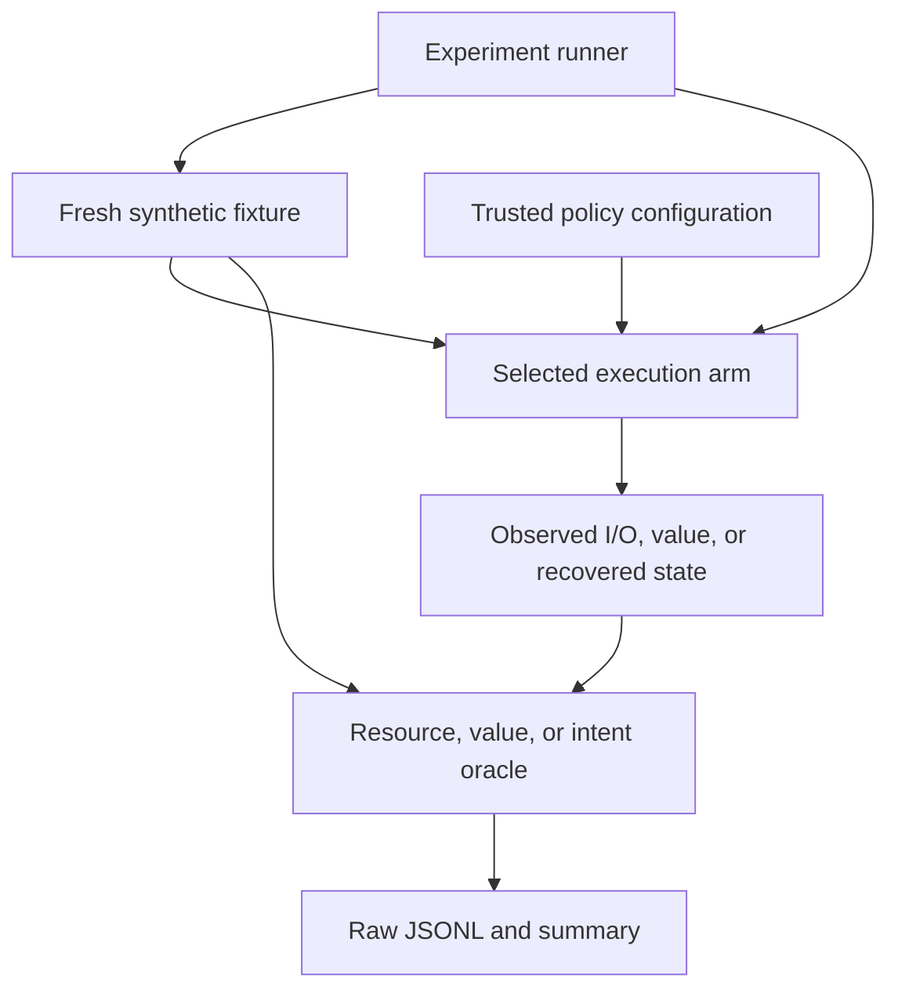

# CodeGuardian

**What binds an authorization decision to the object, value or request that takes effect?**

CodeGuardian is a reproducible systems-security study of authorization across execution, recovery and repeated requests. Twenty experimental stages test how authorization can diverge from the resource, value, or publication intent ultimately used. The experiments execute real file operations on disposable synthetic fixtures; live-agent effectiveness has not been evaluated.

[Documentation](docs/README.md) · [Research statement](docs/RESEARCH_STATEMENT.md) · [Evidence](docs/EVIDENCE.md) · [Reproduction guide](experiments/README.md) · [Threat model and limits](docs/LIMITATIONS.md)

## Research question and contribution

Approving a pathname does not ensure that a later operation reaches the approved object. Holding that object open does not freeze its contents. Returning an approved version does not ensure that the version is current. Completing one file replacement does not ensure that content and approval can be recovered together. Recovering a coherent approval does not ensure that retrying a publication preserves later decisions. Removing a retry receipt does not retire the request that produced it. A separate final admission check can still become obsolete before the write commits. Preventing a duplicate effect still leaves the obligation to return the correct result to both callers. Deleting the original receipt can preserve mutation safety while making that historical result unavailable. A compact replacement must retain the right evidence and survive its own migration boundary. Its source selection must also include requests that commit before the old records are removed. Preserving that evidence does not ensure migration finishes within a finite retry budget. Restart can also forget that budget or return an exhausted result for a target already committed. With overlapping resumption, a justified exhaustion snapshot can precede peer completion, while all reserved permission can be consumed without closing the target. Reassigning reusable permission then requires fencing the displaced holder at the write boundary. The replacement request also needs a durable identity and result; current authority cannot substitute for its historical outcome.

This repository makes those distinctions testable through:

- **Counterexamples and bounded interventions:** lexical checks → resolved targets → file identity → descriptor binding → verified content → approval revisions → restart recovery → request identity → receipt retirement → overlapping admission → concurrent caller outcomes → resolution during retirement → compact receipt recovery → concurrent source completeness → bounded migration progress → restart accounting and outcome continuity → overlapping recovery and observation-time truth → reusable authority and transactional fencing → recovery-request result continuity.
- **Separate protection and usefulness measures:** resource effects, task goals, content delivery, request effects, and historical replies have explicit, different denominators.
- **An auditable evidence trail:** protocols, case manifests, raw records, summaries, and source hashes retain both successful controls and failures.

The mechanisms are established systems concepts. The contribution is the experimental argument and its reproducibility. See the [research statement](docs/RESEARCH_STATEMENT.md) for the reasoning and [evidence map](docs/EVIDENCE.md) for all twenty stages.

## Quick reproduction

Use **Python 3.11+ on Linux**, with hardlink, symlink, FIFO, and `pread` support. The standard library, including the `sqlite3` extension, is sufficient; no model credentials or downloaded dataset are required. The full suite also requires file/directory fsync, selectors on process pipes, and numeric SQLite error metadata. Earlier standalone runners retain their recorded requirements.

```bash
git clone https://github.com/hylen707/AI-agentic-Code-Guardian-Cybersecurity.git
cd AI-agentic-Code-Guardian-Cybersecurity
python -m unittest discover -s tests -v
python experiments/run_request_comparison.py \
  --output /tmp/codeguardian-request-v1.jsonl \
  --base-commit 28d841f5eac844a2389cc3ff513fedde962e45ce \
  --freeze-commit d2ffbb5de6d9bec79a2a70273510ee338c9e28b9
python experiments/verify_request_results.py /tmp/codeguardian-request-v1.metadata.json
```

The latest study produces **72 case/arm records** from a prospectively frozen 24-case manifest. Original recovery-result probes are correct in **0/60 → 36/60 → 60/60** observations for current-only, separate-receipt and atomic-receipt treatment. Grants not justified by the ID's first decision fall from **4 → 2 → 0**. All arms close their targets and preserve publication history, so completion alone does not establish request/result continuity. All **517 tests** pass. [Findings and evidence](docs/REQUEST_FINDINGS.md).

Phases 19–20 use reusable authority with append-only token grants, not a refund of Phase 18's cumulative attempt budget. Historical receipt fields describe an old outcome; they are never installed as current authority.

The preceding [simultaneous-resumption pilot](docs/RESUMPTION_FINDINGS.md) remains a separate post hoc study; its 14 records are not pooled with Phase 18.

## Representative findings

Each row belongs to a different study. **Do not pool the counts into an overall security percentage.**

| Question | Observed result | Interpretation and evidence |
|---|---|---|
| Does label agreement imply useful protection? | 45/45 policy-label matches; subsequent replay still has two symlink misses and two legitimate task losses. | Label conformance and safe task completion differ. [Phases 1–2](docs/EVIDENCE.md#phases-1-and-2-labels-versus-resource-effects) |
| Does pre-open identity approval survive name replacement? | Protected content operations: 6/6 baseline → 4/6 identity-path → **0/6 descriptor-bound**; original-object completion: **8/8** for the descriptor arm. | The descriptor arm still opens two protected objects for metadata checks before denial. [Phase 5](docs/RACE_FINDINGS.md) |
| Does a content hash authorize a later reread? | Unapproved deliveries: 5/5 identity-only → 3/5 hash/reread → **0/5 verified buffer**. | The buffer delivers approved values in 6/8 cases, denies two, and returns three approved but stale values. [Phase 6](docs/CONTENT_FINDINGS.md) |
| Does a final approval check survive a later revocation? | Invalid receipts: 5/5 snapshot-only → 2/5 separate recheck → **0/5 coordinated release**. | Two publications are delayed until after receipt; two valid receipts subsequently become obsolete. [Phase 7](docs/REVISION_FINDINGS.md) |
| Does rejecting a mismatched recovery restore useful state? | Split validation: 0/2 invalid deliveries but 13/15 valid reads. One SQLite transaction: **0/2 invalid deliveries and 15/15 valid reads**. | Persisted state coherence is 17/19 versus 19/19; the fault model excludes host power loss. [Phase 8](docs/RECOVERY_FINDINGS.md) |
| Does coherent state make a request safe to retry? | Successful retries: 2/12 unkeyed → 10/12 separate receipt → **12/12 atomic receipt**. | Two separate-receipt gaps repeat a committed effect. Old receipts must preserve later policy. [Phase 9](docs/RETRY_FINDINGS.md) |
| Does deleting receipts retire old intent? | Extra effects in ten known-request schedules: retain **0**, forget **6**, delete/fence separately **2**, atomic retirement **0**. | Compact retirement preserves later policy by rejecting old epochs; six historical commitments are no longer returned. [Phase 10](docs/RETIREMENT_FINDINGS.md) |
| Does a final epoch check survive overlapping retirement? | Invalid old effects: 4/4 cached → 2/4 separate recheck → **0/4 transactional admission**. | Holding the writer defers six retirements; all complete on scheduled retry. A late reply can describe a valid earlier effect. [Phase 11](docs/OVERLAP_FINDINGS.md) |
| Does one committed effect imply correct caller responses? | One shared effect: **15/15 each**; correct overlapping caller pairs: **0/12 → 6/12 → 12/12 → 12/12**. | Errors and false conflicts remain failures. Receipt resolution and transactional lookup both work under retained receipts. [Phase 12](docs/CALLER_FINDINGS.md) |
| What if retirement deletes a receipt before duplicate resolution? | Extra effects: **12/12 → 0/12 → 0/12**; original outcomes available: **0/12 → 0/12 → 12/12**. | Safe unavailable responses and original replies differ. Guarded lookup defers twelve retirements. [Phase 13](docs/RESOLUTION_FINDINGS.md) |
| Can a compact replacement preserve the original result through interruption? | Original replays: **20/20 → 12/20 → 12/20 → 20/20**; cleanup/summary-gap replies: **8/8 → 8/8 → 0/8 → 8/8**. | Equal aggregate replay totals conceal different loss windows. Atomic migration preserves typed summaries under the hash assumption. [Phase 14](docs/COMPACTION_FINDINGS.md) |
| Does an atomic migration include every request that committed before closure? | Lost committed receipts in eight source gaps: **8 → 4 → 0 → 0**. | Transactional selection completes 6/20 old intents; validated selection completes 14/20 with eight migration retries. Receipt safety and useful work differ. [Phase 15](docs/SELECTION_FINDINGS.md) |
| Does a finite retry limit preserve history and finish migration? | Migration completion: **12/24 → 24/24 → 24/24**; old publication completion: **42/42 → 0/42 → 16/42**. | Exhaustion retains full authority; the final-attempt writer scope trades old work for closure in the arranged schedule. [Phase 16](docs/PROGRESS_FINDINGS.md) |
| Do the attempt limit and reported outcome survive restart? | Budget overruns: **12/28 → 8/28 → 0/28 → 0/28**; false exhaustion: **0 → 0 → 2 → 0**. | Reserving before work preserves the bound; reconciling the target preserves terminal truth. A slot may be spent without completing migration. [Phase 17](docs/RESTART_FINDINGS.md) |
| Can shared resumption stay bounded through overlap and interruption? | Caller errors: **12/64 → 0/64**; final closure: **22/32 in both arms**. | All reservations stay bounded and 76/76 originals replay per arm; two exhaustion observations precede peer completion. [Phase 18](docs/RESUME_FINDINGS.md) |
| Does replacement stop the former authority holder? | Invalid effects: **10/20 → 2/20 → 0/20**; all arms close 20/20 targets. | A separate token check can become obsolete; the transactional check defers recovery while the authorized writer commits. Reusable authority differs from a lifetime budget. [Phase 19](docs/RECLAIM_FINDINGS.md) |
| Does an interrupted replacement retain its original request result? | Correct original probes: **0/60 → 36/60 → 60/60**; unjustified grants: **4 → 2 → 0**. | A separate receipt can certify a later conflict after an earlier grant; atomic request/result coupling preserves history without restoring old authority. [Phase 20](docs/REQUEST_FINDINGS.md) |

Resolved-target and hardlink studies supply the intermediate steps; their separate controls, counts, and raw artifacts are in the [evidence map](docs/EVIDENCE.md).

## Experimental structure



The runner controls replacement, mutation, approval-transition, process-exit, or pipe-barrier ordering and supplies each arm with a fresh fixture. The oracle evaluates effects or returned bytes, rather than treating an allow/block label as protection. [Architecture](docs/ARCHITECTURE.md) describes the components, trust boundaries, and descriptor/buffer lifetimes.

## Scope and next question

These are curated, developer-visible mechanism studies with deterministic schedules. They do not estimate concurrent race probability, provide a production sandbox, or establish live-agent task performance. The content reader validates small UTF-8 values and may inspect rejected bytes. The revision authority adds a receipt-time contract for cooperating publishers in one process; it can delay updates and does not guarantee freshness after receipt. See the [threat model and validity limits](docs/LIMITATIONS.md).

Phase 18 separates bounded admission from actual closure and observation-time responses. Phase 19 tests explicit trusted replacement under a reusable-authority contract; it fences stale holders without claiming automatic failure detection. Phase 20 couples recovery-request identity and result across loss, overlap, later replacement and closure. Its next question is bounded result retention without reopening old request IDs. General many-caller histories, fairness, caller authentication, clock-based expiration, and failures inside storage operations remain untested.

## Read further

| Purpose | Start here |
|---|---|
| Follow the full argument | [Research statement](docs/RESEARCH_STATEMENT.md) |
| Audit claims, denominators, and artifacts | [Evidence map](docs/EVIDENCE.md) and [evaluation standards](docs/EXPERIMENT_PLAN.md) |
| Run or inspect the implementation | [Experiment guide](experiments/README.md) and [source guide](src/README.md) |
| Find protocols, findings, and project history | [Documentation index](docs/README.md) |

Technical artifacts do not establish independent personal authorship or learning; see [attribution and interpretation](docs/RESEARCH_STATEMENT.md#attribution-and-interpretation).
