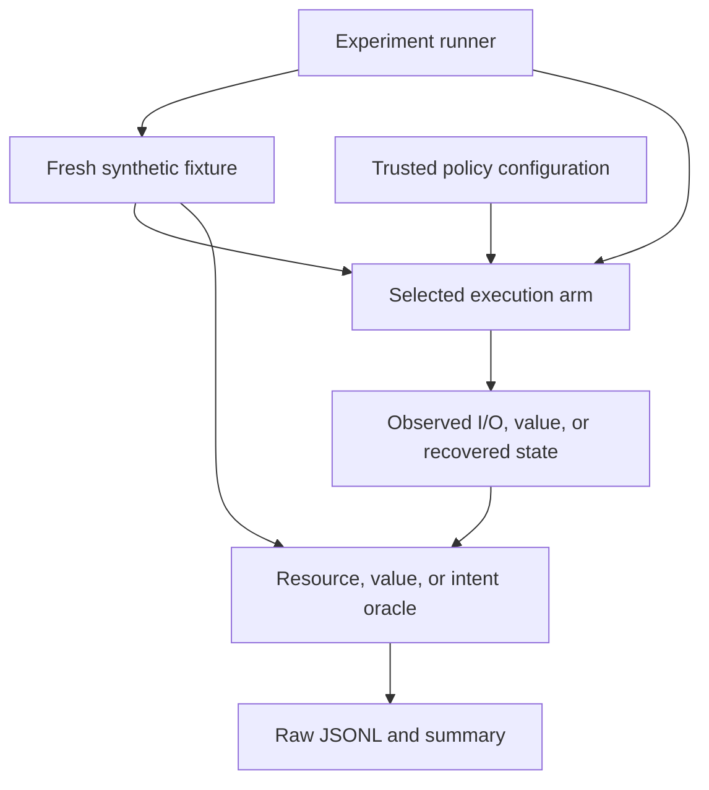

# CodeGuardian

**What binds an authorization decision to the object, value or request that takes effect?**

CodeGuardian is a reproducible systems-security study of the gap between filesystem authorization and execution. Fourteen experimental stages test how authorization can diverge from the resource, value, or publication intent ultimately used. The experiments execute real file operations on disposable synthetic fixtures; live-agent effectiveness has not been evaluated.

[Documentation](docs/README.md) · [Research statement](docs/RESEARCH_STATEMENT.md) · [Evidence](docs/EVIDENCE.md) · [Reproduction guide](experiments/README.md) · [Threat model and limits](docs/LIMITATIONS.md)

## Research question and contribution

Approving a pathname does not ensure that a later operation reaches the approved object. Holding that object open does not freeze its contents. Returning an approved version does not ensure that the version is current. Completing one file replacement does not ensure that content and approval can be recovered together. Recovering a coherent approval does not ensure that retrying a publication preserves later decisions. Removing a retry receipt does not retire the request that produced it. A separate final admission check can still become obsolete before the write commits. Preventing a duplicate effect still leaves the obligation to return the correct result to both callers. Deleting the original receipt can preserve mutation safety while making that historical result unavailable. A compact replacement must retain the right evidence and survive its own migration boundary.

This repository makes those distinctions testable through:

- **Counterexamples and bounded interventions:** lexical checks → resolved targets → file identity → descriptor binding → verified content → approval revisions → restart recovery → request identity → receipt retirement → overlapping admission → concurrent caller outcomes → resolution during retirement → compact receipt recovery.
- **Separate protection and usefulness measures:** resource effects, task goals, content delivery, request effects, and historical replies have explicit, different denominators.
- **An auditable evidence trail:** protocols, case manifests, raw records, summaries, and source hashes retain both successful controls and failures.

The mechanisms are established systems concepts. The contribution is the experimental argument and its reproducibility. See the [research statement](docs/RESEARCH_STATEMENT.md) for the reasoning and [evidence map](docs/EVIDENCE.md) for all fourteen stages.

## Quick reproduction

Use **Python 3.11+ on Linux**, with hardlink, symlink, FIFO, and `pread` support. The standard library, including the `sqlite3` extension, is sufficient; no model credentials or downloaded dataset are required. The full suite also requires file/directory fsync, selectors on process pipes, and numeric SQLite error metadata. Earlier standalone runners retain their recorded requirements.

```bash
git clone https://github.com/hylen707/AI-agentic-Code-Guardian-Cybersecurity.git
cd AI-agentic-Code-Guardian-Cybersecurity
python -m unittest discover -s tests -v
python experiments/run_compaction_comparison.py \
  --dataset experiments/tasks/compaction-eval-v1/tasks.json \
  --base-commit "$(git rev-parse HEAD)" \
  --freeze-commit 89902786509e97cfe8d4f24f02cde0457acda0e8
```

The latest study produces **104 case/mode records** comparing retained full receipts, deletion, split summary migration and atomic summary migration. Correct original replays across twenty cases are **20/20 → 12/20 → 12/20 → 20/20**; changed-intent classification is **4/4 → 0/4 → 4/4 → 4/4**. Split migration loses all eight replies in its selected cleanup/summary gaps. Atomic migration preserves those replies while removing old receipt payload BLOBs after completed migration, under a stated SHA-256 comparison assumption. All **316 unit tests** pass. This is logical receipt representation and process-exit recovery, not a total-space or secure-erasure claim. See the [findings](docs/COMPACTION_FINDINGS.md), [raw evidence](docs/EVIDENCE.md#phase-14-compact-receipts-and-migration-recovery), and [reproduction guide](experiments/README.md).

## Representative findings

Each row belongs to a different study. **Do not pool the counts into an overall security percentage.**

| Question | Observed result | Interpretation and evidence |
|---|---|---|
| Does label agreement imply useful protection? | 45/45 policy-label matches; subsequent replay still has two symlink misses and two legitimate task losses. | Label conformance and safe task completion differ. [Phases 1–2](docs/EVIDENCE.md#phases-1-and-2-labels-versus-resource-effects) |
| Does pre-open identity approval survive name replacement? | Protected content operations: 6/6 baseline → 4/6 identity-path → **0/6 descriptor-bound**; original-object completion: **8/8** for the descriptor arm. | The descriptor arm still opens two protected objects for metadata checks before denial. [Phase 5](docs/RACE_FINDINGS.md) |
| Does a content hash authorize a later reread? | Unapproved deliveries: 5/5 identity-only → 3/5 hash/reread → **0/5 verified buffer**. | The buffer delivers approved values in 6/8 cases, denies two, and returns three approved but stale values. [Phase 6](docs/CONTENT_FINDINGS.md) |
| Does a final approval check survive a later revocation? | Invalid receipts: 5/5 snapshot-only → 2/5 separate recheck → **0/5 coordinated release**. | Two publications are delayed until after receipt; two valid receipts subsequently become obsolete. [Phase 7](docs/REVISION_FINDINGS.md) |
| Does rejecting a mismatched recovery restore useful state? | Split validation: 0/2 invalid deliveries but 13/15 valid reads. One SQLite transaction: **0/2 invalid deliveries and 15/15 valid reads**. | Persisted state coherence is 17/19 versus 19/19; the fault model excludes host power loss. [Phase 8](docs/RECOVERY_FINDINGS.md) |
| Does coherent state make a request safe to retry? | Successful retries: 2/12 unkeyed → 10/12 separate receipt → **12/12 atomic receipt**. | Two separate-receipt gaps repeat a committed effect. Old receipts must preserve later policy. [Phase 9](docs/RETRY_FINDINGS.md) |
| Does deleting receipts retire old intent? | Extra effects in ten known-request schedules: retain **0**, forget **6**, delete/fence separately **2**, atomic retirement **0**. | Compact retirement preserves later policy by rejecting old epochs; six historical commitments are no longer returned. [Phase 10](docs/RETIREMENT_FINDINGS.md) |
| Does a final epoch check survive overlapping retirement? | Invalid old effects: 4/4 cached → 2/4 separate recheck → **0/4 transactional admission**. | Holding the writer defers six retirements; all complete on scheduled retry. A late reply can describe a valid earlier effect. [Phase 11](docs/OVERLAP_FINDINGS.md) |
| Does one committed effect imply correct caller responses? | One shared effect: **15/15 each**; correct overlapping caller pairs: **0/12 → 6/12 → 12/12 → 12/12**. | Errors and false conflicts remain failures. Receipt resolution and transactional lookup both work under retained receipts. [Phase 12](docs/CALLER_FINDINGS.md) |
| What if retirement deletes a receipt before duplicate resolution? | Extra effects: **12/12 → 0/12 → 0/12**; original outcomes available: **0/12 → 0/12 → 12/12**. | Safe unavailable responses and original replies differ. Guarded lookup defers twelve retirements. [Phase 13](docs/RESOLUTION_FINDINGS.md) |
| Can a compact replacement preserve the original result through interruption? | Original replays: **20/20 → 12/20 → 12/20 → 20/20**; cleanup/summary-gap replies: **8/8 → 8/8 → 0/8 → 8/8**. | Equal aggregate replay totals conceal different loss windows. Atomic migration preserves typed summaries under the hash assumption. [Phase 14](docs/COMPACTION_FINDINGS.md) |

Resolved-target and hardlink studies supply the intermediate steps; their separate controls, counts, and raw artifacts are in the [evidence map](docs/EVIDENCE.md).

## Experimental structure



The runner controls replacement, mutation, approval-transition, process-exit, or pipe-barrier ordering and supplies each arm with a fresh fixture. The oracle evaluates effects or returned bytes, rather than treating an allow/block label as protection. [Architecture](docs/ARCHITECTURE.md) describes the components, trust boundaries, and descriptor/buffer lifetimes.

## Scope and next question

These are curated, developer-visible mechanism studies with deterministic schedules. They do not estimate concurrent race probability, provide a production sandbox, or establish live-agent task performance. The content reader validates small UTF-8 values and may inspect rejected bytes. The revision authority adds a receipt-time contract for cooperating publishers in one process; it can delay updates and does not guarantee freshness after receipt. See the [threat model and validity limits](docs/LIMITATIONS.md).

The latest study separates historical evidence from its payload representation and tests how that evidence survives migration. The next question is concurrent publication while migration selects its source records: an atomic write cannot repair a stale selection made earlier. Many-caller histories, fairness, caller authentication, clock-based expiration, and failures inside storage operations remain untested.

## Read further

| Purpose | Start here |
|---|---|
| Follow the full argument | [Research statement](docs/RESEARCH_STATEMENT.md) |
| Audit claims, denominators, and artifacts | [Evidence map](docs/EVIDENCE.md) and [evaluation standards](docs/EXPERIMENT_PLAN.md) |
| Run or inspect the implementation | [Experiment guide](experiments/README.md) and [source guide](src/README.md) |
| Find protocols, findings, and project history | [Documentation index](docs/README.md) |

Technical artifacts do not establish independent personal authorship or learning; see [attribution and interpretation](docs/RESEARCH_STATEMENT.md#attribution-and-interpretation).
