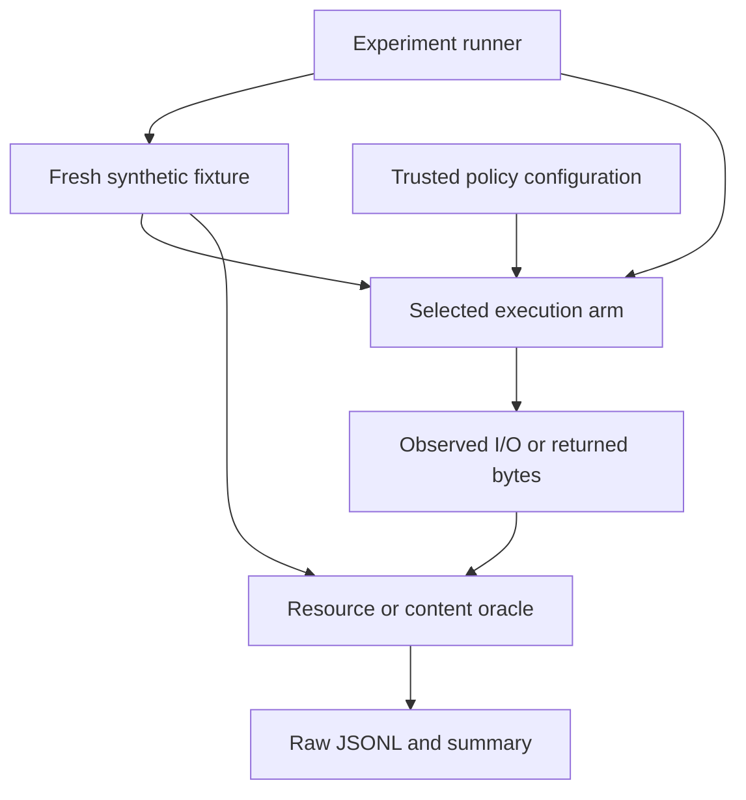

# CodeGuardian

**What must a runtime safeguard authorize: a path, an object, or a content version?**

CodeGuardian is a reproducible systems-security study motivated by AI coding agents. Six experimental stages test how filesystem authorization can diverge from the resource or value ultimately used. The experiments execute real file operations on disposable synthetic fixtures; live-agent effectiveness has not been evaluated.

[Documentation](docs/README.md) · [Research statement](docs/RESEARCH_STATEMENT.md) · [Evidence](docs/EVIDENCE.md) · [Reproduction guide](experiments/README.md) · [Threat model and limits](docs/LIMITATIONS.md)

## Research question and contribution

Approving a pathname does not ensure that a later operation reaches the approved object. Holding that object open does not freeze its contents. Returning an approved version does not ensure that the version is current.

This repository makes those distinctions testable through:

- **Counterexamples and bounded interventions:** lexical checks → resolved targets → file identity → descriptor binding → verified content delivery.
- **Separate protection and usefulness measures:** resource effects, task goals, content delivery, and freshness have explicit, different denominators.
- **An auditable evidence trail:** protocols, case manifests, raw records, summaries, and source hashes retain both successful controls and failures.

The mechanisms are established systems concepts. The contribution is the experimental argument and its reproducibility. See the [research statement](docs/RESEARCH_STATEMENT.md) for the reasoning and [evidence map](docs/EVIDENCE.md) for all six stages.

## Quick reproduction

Use **Python 3.10+ on Linux**, with hardlink, symlink, FIFO, and `pread` support. The standard library is sufficient; no model credentials or downloaded dataset are required.

```bash
git clone https://github.com/hylen707/AI-agentic-Code-Guardian-Cybersecurity.git
cd AI-agentic-Code-Guardian-Cybersecurity
python -m unittest discover -s tests -v
python experiments/run_content_comparison.py \
  --dataset experiments/tasks/content-eval-v1/tasks.json \
  --base-commit "$(git rev-parse HEAD)" \
  --freeze-commit ce3fd6d245a2013090f7bd8c6367d08895132723
```

The latest study produces **24 case/arm records** and a summary under `experiments/results/`, using a new UTC timestamp. Expect unapproved deliveries of **5 → 3 → 0** across the three arms, two version denials in each digest arm, and three approved but stale values in the buffer arm. Exit 0 alone does not establish these outcomes; inspect the summary's `criteria` and raw rows. The [reproduction guide](experiments/README.md) explains provenance, outputs, and commands for every stage.

## Representative findings

Each row belongs to a different study. **Do not pool the counts into an overall security percentage.**

| Question | Observed result | Interpretation and evidence |
|---|---|---|
| Does label agreement imply useful protection? | 45/45 policy-label matches; subsequent replay still has two symlink misses and two legitimate task losses. | Label conformance and safe task completion differ. [Phases 1–2](docs/EVIDENCE.md#phases-1-and-2-labels-versus-resource-effects) |
| Does pre-open identity approval survive name replacement? | Protected content operations: 6/6 baseline → 4/6 identity-path → **0/6 descriptor-bound**; original-object completion: **8/8** for the descriptor arm. | The descriptor arm still opens two protected objects for metadata checks before denial. [Phase 5](docs/RACE_FINDINGS.md) |
| Does a content hash authorize a later reread? | Unapproved deliveries: 5/5 identity-only → 3/5 hash/reread → **0/5 verified buffer**. | The buffer delivers approved values in 6/8 cases, denies two, and returns three approved but stale values. [Phase 6](docs/CONTENT_FINDINGS.md) |

Resolved-target and hardlink studies supply the intermediate steps; their separate controls, counts, and raw artifacts are in the [evidence map](docs/EVIDENCE.md).

## Experimental structure



The runner controls replacement or mutation timing and supplies each arm with a fresh fixture. The oracle evaluates effects or returned bytes, rather than treating an allow/block label as protection. [Architecture](docs/ARCHITECTURE.md) describes the components, trust boundaries, and descriptor/buffer lifetimes.

## Scope and next question

These are curated, developer-visible mechanism studies with deterministic schedules. They do not estimate concurrent race probability, provide a production sandbox, or establish live-agent task performance. The latest reader validates small UTF-8 values under static trusted digests; it may inspect rejected bytes and may return an older approved value. See the [threat model and validity limits](docs/LIMITATIONS.md).

The next question is how legitimate new versions become authorized and how consumers handle approved but stale values. That study has not been completed.

## Read further

| Purpose | Start here |
|---|---|
| Follow the full argument | [Research statement](docs/RESEARCH_STATEMENT.md) |
| Audit claims, denominators, and artifacts | [Evidence map](docs/EVIDENCE.md) and [evaluation standards](docs/EXPERIMENT_PLAN.md) |
| Run or inspect the implementation | [Experiment guide](experiments/README.md) and [source guide](src/README.md) |
| Find protocols, findings, and project history | [Documentation index](docs/README.md) |

This continuation includes AI-assisted design, implementation, execution, analysis, and editing. Technical artifacts do not establish independent personal authorship or learning; see [attribution and interpretation](docs/RESEARCH_STATEMENT.md#attribution-and-interpretation).
