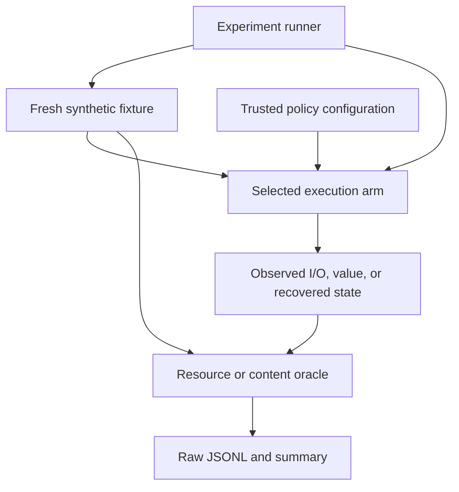

# CodeGuardian

**What must a runtime safeguard authorize: a path, an object, or a content version?**

CodeGuardian is a reproducible systems-security study of the gap between filesystem authorization and execution. Eight experimental stages test how filesystem authorization can diverge from the resource or value ultimately used. The experiments execute real file operations on disposable synthetic fixtures; live-agent effectiveness has not been evaluated.

[Documentation](docs/README.md) · [Research statement](docs/RESEARCH_STATEMENT.md) · [Evidence](docs/EVIDENCE.md) · [Reproduction guide](experiments/README.md) · [Threat model and limits](docs/LIMITATIONS.md)

## Research question and contribution

Approving a pathname does not ensure that a later operation reaches the approved object. Holding that object open does not freeze its contents. Returning an approved version does not ensure that the version is current. Completing one file replacement does not ensure that content and approval can be recovered together.

This repository makes those distinctions testable through:

- **Counterexamples and bounded interventions:** lexical checks → resolved targets → file identity → descriptor binding → verified content → approval revisions → restart recovery.
- **Separate protection and usefulness measures:** resource effects, task goals, content delivery, and freshness have explicit, different denominators.
- **An auditable evidence trail:** protocols, case manifests, raw records, summaries, and source hashes retain both successful controls and failures.

The mechanisms are established systems concepts. The contribution is the experimental argument and its reproducibility. See the [research statement](docs/RESEARCH_STATEMENT.md) for the reasoning and [evidence map](docs/EVIDENCE.md) for all eight stages.

## Quick reproduction

Use **Python 3.10+ on Linux**, with hardlink, symlink, FIFO, and `pread` support. The standard library, including the `sqlite3` extension, is sufficient; no model credentials or downloaded dataset are required. The latest study also requires file and directory fsync support.

```bash
git clone https://github.com/hylen707/AI-agentic-Code-Guardian-Cybersecurity.git
cd AI-agentic-Code-Guardian-Cybersecurity
python -m unittest discover -s tests -v
python experiments/run_recovery_comparison.py \
  --dataset experiments/tasks/recovery-eval-v1/tasks.json \
  --base-commit "$(git rev-parse HEAD)" \
  --freeze-commit b9f4d344f6589a0069b39f02bc9552517b06cacd
```

The latest study produces **57 case/arm records**: 19 cases across split-unchecked, split-verified, and SQLite-transactional stores. Both verified designs prevent the two selected invalid deliveries. Split verification denies the two mismatched pairs, yielding 13/15 authorized reads; the transactional store recovers coherent old-or-new state and yields **15/15**. All **111 unit tests** pass in the recorded run. This is process-exit recovery at application checkpoints, not a power-loss test. See the [findings](docs/RECOVERY_FINDINGS.md), [raw evidence](docs/EVIDENCE.md#phase-8-recovered-state-and-authorized-availability), and [reproduction guide](experiments/README.md).

## Representative findings

Each row belongs to a different study. **Do not pool the counts into an overall security percentage.**

| Question | Observed result | Interpretation and evidence |
|---|---|---|
| Does label agreement imply useful protection? | 45/45 policy-label matches; subsequent replay still has two symlink misses and two legitimate task losses. | Label conformance and safe task completion differ. [Phases 1–2](docs/EVIDENCE.md#phases-1-and-2-labels-versus-resource-effects) |
| Does pre-open identity approval survive name replacement? | Protected content operations: 6/6 baseline → 4/6 identity-path → **0/6 descriptor-bound**; original-object completion: **8/8** for the descriptor arm. | The descriptor arm still opens two protected objects for metadata checks before denial. [Phase 5](docs/RACE_FINDINGS.md) |
| Does a content hash authorize a later reread? | Unapproved deliveries: 5/5 identity-only → 3/5 hash/reread → **0/5 verified buffer**. | The buffer delivers approved values in 6/8 cases, denies two, and returns three approved but stale values. [Phase 6](docs/CONTENT_FINDINGS.md) |
| Does a final approval check survive a later revocation? | Invalid receipts: 5/5 snapshot-only → 2/5 separate recheck → **0/5 coordinated release**. | Two publications are delayed until after receipt; two valid receipts subsequently become obsolete. [Phase 7](docs/REVISION_FINDINGS.md) |
| Does rejecting a mismatched recovery restore useful state? | Split validation: 0/2 invalid deliveries but 13/15 valid reads. One SQLite transaction: **0/2 invalid deliveries and 15/15 valid reads**. | Persisted state coherence is 17/19 versus 19/19; the fault model excludes host power loss. [Phase 8](docs/RECOVERY_FINDINGS.md) |

Resolved-target and hardlink studies supply the intermediate steps; their separate controls, counts, and raw artifacts are in the [evidence map](docs/EVIDENCE.md).

## Experimental structure



The runner controls replacement, mutation, approval-transition, or process-exit timing and supplies each arm with a fresh fixture. The oracle evaluates effects or returned bytes, rather than treating an allow/block label as protection. [Architecture](docs/ARCHITECTURE.md) describes the components, trust boundaries, and descriptor/buffer lifetimes.

## Scope and next question

These are curated, developer-visible mechanism studies with deterministic schedules. They do not estimate concurrent race probability, provide a production sandbox, or establish live-agent task performance. The content reader validates small UTF-8 values and may inspect rejected bytes. The revision authority adds a receipt-time contract for cooperating publishers in one process; it can delay updates and does not guarantee freshness after receipt. See the [threat model and validity limits](docs/LIMITATIONS.md).

The latest study examines recovery of content and approval after publisher termination. The next question is how a caller safely retries a publication whose commit succeeded but acknowledgment was lost. Request deduplication and failures inside storage operations remain untested.

## Read further

| Purpose | Start here |
|---|---|
| Follow the full argument | [Research statement](docs/RESEARCH_STATEMENT.md) |
| Audit claims, denominators, and artifacts | [Evidence map](docs/EVIDENCE.md) and [evaluation standards](docs/EXPERIMENT_PLAN.md) |
| Run or inspect the implementation | [Experiment guide](experiments/README.md) and [source guide](src/README.md) |
| Find protocols, findings, and project history | [Documentation index](docs/README.md) |

Technical artifacts do not establish independent personal authorship or learning; see [attribution and interpretation](docs/RESEARCH_STATEMENT.md#attribution-and-interpretation).
