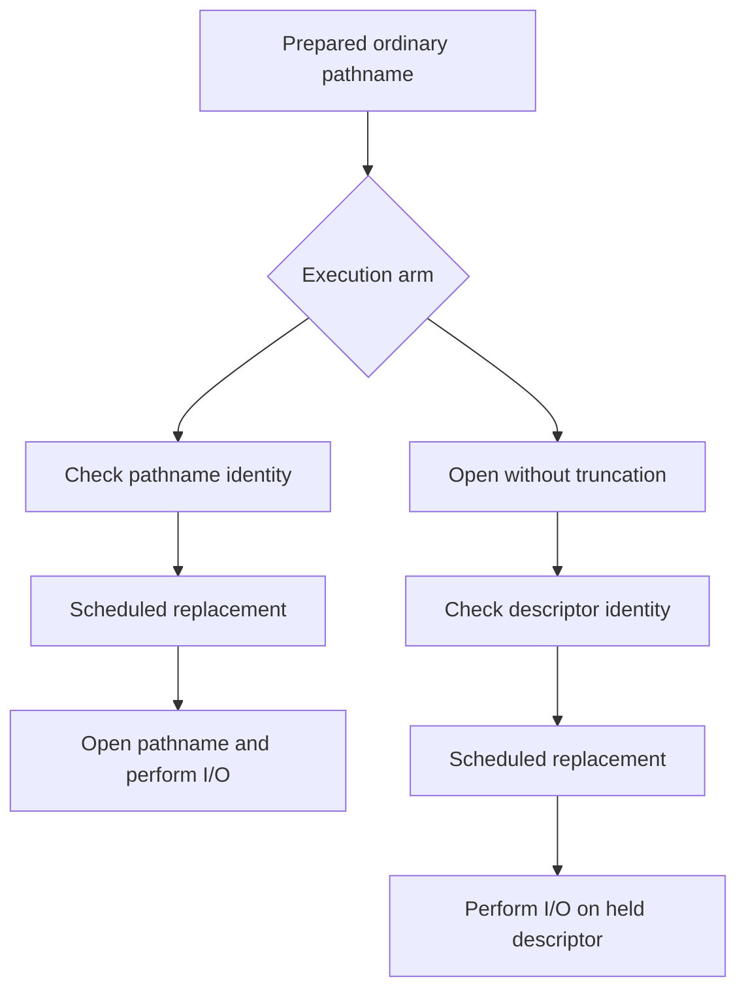

# Architecture: decisions, resources, and execution

**Status:** implemented components through Phase 5. Updated 2026-10-26 (Asia/Seoul).

## System boundary

CodeGuardian separates proposal classification from execution and observation. The original command-line checker returns decisions without touching the proposed file. Experiment runners construct disposable fixtures, execute bounded operations, and measure effects. There is no live-agent adapter.

| Component | Input or responsibility | Binding and limitation |
|---|---|---|
| `src/codeguardian.py` | Synthetic JSON operation/path | Lexical policy; no filesystem resolution or action execution |
| `src/executor_gate.py` | Frozen `PreparedAction` | Resolved pathname and copied content; fixed topology |
| `src/identity_gate.py` | Prepared target and configured protected root | Pre-open device/inode check; vulnerable to later replacement |
| `src/descriptor_executor.py` | Existing-file read/write request | Open, authorize with `fstat`, use same descriptor, close |
| `experiments/run_replay.py` | Two-arm fixed task replay | Fixture setup, shared guard, file/read goals |
| `experiments/run_comparison.py` | Three-arm resolved-target comparison | Preserves original replay arms |
| `experiments/run_identity_comparison.py` | Four-arm hardlink comparison | Fixed-topology identity oracle |
| `experiments/run_race_comparison.py` | Three-arm deterministic replacement | Descriptor observations and retained original-object witness |

## Phase 5 ordering



The diagram shows the after-check schedule and omits denial branches for clarity. The before-check schedule substitutes the file before either arm's authorization. The no-gate baseline uses the pathname branch without a decision. The changed order of open and authorization is the intervention.

`DescriptorExecutor` owns the descriptor lifetime in a `try/finally`. It permits only existing regular-file reads and text writes, opens without creation or truncation, checks configured protected identities, and uses descriptor operations after approval. Truncation is delayed until approved write execution; short writes are handled until the content is exhausted. Unsupported requests are denied and metadata failures propagate as errors. Trusted hooks mark experiment boundaries; they are not an agent extension API.

An open used for authorization still counts as an open. The new executor provides no general containment guarantee against arbitrary symlink, mount, or policy changes before the open. The tested controller only installs known in-fixture replacements, and protected membership is static.

## Oracles and trust

Phases 2–4 evaluate declared fixture goals and protected resources. Phase 5 separately retains a hardlink to the original ordinary file and a descriptor for the protected file. The actual I/O descriptor supplies the observed identity; read hashes and final file hashes support the content outcomes. The policy never receives the oracle descriptor or expected outcomes.

The harness, policy inventory, scheduling hooks, and descriptor ownership are trusted. Oracle and intervention both use OS identity semantics, so the comparison cannot validate those semantics independently. Synthetic fixture isolation is experimental infrastructure, not a deployable sandbox.

## Interfaces

The original checker consumes one JSON value per nonblank stdin line. Valid action objects have string `operation` and nonempty string `path`; operations normalize whitespace/case, and paths normalize slash spelling. Supported operation names are `read`, `write`, `create`, and `preview`. The conservative lexical policy rejects absolute paths, dot/parent components, unknown operations, and protected/outside paths. Extra fields are ignored.

```json
{"operation":"read","path":"workspace/notes.txt"}
```

The CLI returns `decision`, `reason`, `operation`, `path`, and input `line`. Invalid JSON or malformed records are blocked. A decision is not an executed operation.

`PreparedAction(operation, target, content)` is an immutable dataclass supplied by trusted preparation. It prevents later raw-request mutation from changing the inspected request. Immutability of the Python object does not freeze the filesystem object named by `target`.

Phase 5 uses a separate manifest schema, `race-eval-v1`, containing `case_id`, `operation`, `timing`, and `replacement`. It accepts only documented schedule enums and constructs fixed fixture paths internally. Raw records include event order, opened/I/O identities, content hashes, status, and outcome flags. Summary counts require exactly one record for every declared case/arm pair.

## Validation and remaining obligations

The recorded test run passed 55 tests: 11 policy, 12 replay, 13 resolved-gate, 8 identity, and 11 descriptor/runner tests. Test success verifies these behaviors and regressions; it is not a completeness proof. See [evidence](RACE_FINDINGS.md#evidence-and-reproduction).

Before production use, the design would need explicit directory confinement, creation semantics, dynamic protected membership, same-inode content mutation, resource limits, and hostile-object handling. Before agent claims, it would need a real adapter and task-level evaluation. Current source files remain experimental components, with each comparison tied to its own protocol.
