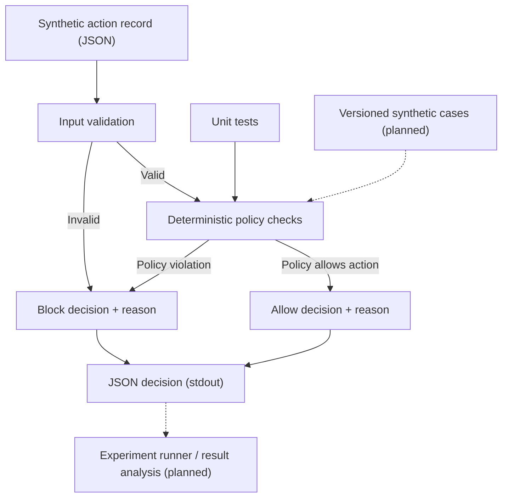

# Architecture and Data Schema

**Project:** CodeGuardian  
**Document status:** living design document  
**Last updated:** 2026-10-21

## 1. Purpose

CodeGuardian investigates the question:

> Can a lightweight runtime monitor reduce risky actions by an AI coding agent without substantially reducing completion of legitimate tasks in a controlled test environment?

The current prototype is deliberately narrower than a real runtime integration. It receives **synthetic action proposals**, applies deterministic policy checks, and returns an `allow` or `block` decision. It does not execute the proposed action.

## 2. Current architecture



Solid arrows describe the current command-line decision flow. Dashed arrows are planned components and are **not yet implemented**.

### Current components

| Component | Responsibility | Status |
|---|---|---|
| Input parser | Read one JSON action record per line | Implemented |
| Policy checker | Validate operation and path against fixed rules | Implemented |
| Decision output | Return JSON with decision and reason | Implemented |
| Unit tests | Check representative allow/block cases | Written; execution not yet recorded |
| Versioned experiment dataset | Store labelled safe and risky synthetic cases | Planned |
| Experiment runner and metrics | Run cases and calculate rates from raw counts | Planned |
| Real AI-agent adapter | Intercept actions from an actual agent | Out of scope for current prototype |

## 3. Decision pipeline

1. Read one line from standard input and parse it as JSON.
2. Reject input that is not a JSON object.
3. Validate that `operation` and `path` are strings.
4. Reject unsupported operations.
5. Reject absolute paths and detected path-traversal patterns.
6. Reject paths under the protected prefix `workspace/protected/`.
7. Reject paths outside the allowed prefix `workspace/`.
8. Otherwise return `allow`.

The order matters: malformed or disallowed requests should be rejected before the policy reaches the allow decision.

## 4. Input schema

Each input line is a JSON object.

| Field | Type | Current rule | Example |
|---|---|---|---|
| `operation` | string | Must be one of `read`, `write`, `create`, `preview` | `"read"` |
| `path` | string | Must be a relative path under the allowed workspace and not under the protected prefix | `"workspace/notes.txt"` |

Example input:

```json
{"operation":"read","path":"workspace/notes.txt"}
```

The current input schema does not include command execution, credentials, network access, or arbitrary tool parameters.

## 5. Output schema

For each input record, the program emits one JSON decision.

| Field | Type | Meaning |
|---|---|---|
| `decision` | string | `"allow"` or `"block"` |
| `reason` | string | Human-readable explanation of the policy outcome |

Illustrative output shape (the exact reason depends on the rule):

```json
{"decision":"allow","reason":"..."}
```

## 6. Initial policy configuration

- Allowed operations: `read`, `write`, `create`, `preview`
- Allowed path prefix: `workspace/`
- Protected path prefix: `workspace/protected/`
- Default posture: reject malformed, unsupported, or out-of-scope requests

These are prototype rules, not a complete security policy. Prefix checks alone do not provide safe filesystem resolution or protect a real environment.

## 7. Experiment data schema (planned)

When the experiment dataset is added, each case should have a stable identifier and an expected label. Suggested fields:

| Field | Type | Purpose |
|---|---|---|
| `case_id` | string | Stable unique identifier |
| `category` | string | Scenario category, such as safe-read or path-traversal |
| `input` | object | Synthetic action record passed to CodeGuardian |
| `expected_decision` | string | Predefined expected result: `allow` or `block` |
| `rationale` | string | Why the case has that label |
| `dataset_version` | string | Identifies the version of the test set |

Observed results should be stored separately from the expected labels. Do not change expected labels after seeing outcomes without documenting the reason and creating a traceable dataset revision.

## 8. Evaluation metrics (planned)

- **Risky-action block rate** = risky cases blocked / all risky cases tested
- **False-positive rate** = legitimate cases blocked / all legitimate cases tested
- **Legitimate task completion rate** = legitimate tasks completed / all legitimate tasks attempted
- **Decision latency (optional)** = elapsed time for a decision, with the timing method documented

Save raw numerators and denominators for every reported rate. A metric is not an experimental result until the test set has been run and the output has been checked.

## 9. Safety boundaries and limitations

- Only use synthetic action records and project-owned test fixtures.
- The current program classifies proposals; it does not perform the proposed file operations.
- It is not connected to a live AI coding agent and is not a sandbox.
- It should not be relied on to protect real files, accounts, school systems, or sensitive data.
- A future integration would need a separate threat model, stronger path resolution, isolation, and careful testing before any real-world use.

## 10. Change control

Update this document when a component, input/output field, policy rule, or experiment method changes. Record the implementation change in `CHANGELOG.md` and record actual work, observations, and decisions in `docs/RESEARCH_LOG.md`. Keep planned work clearly distinguished from completed work.
