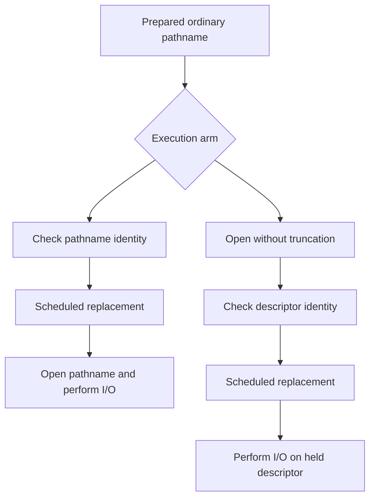

# Architecture: decisions, resources, and execution

**Status:** implemented components through Phase 16. Updated 2026-11-10 (Asia/Seoul).

## System boundary

CodeGuardian separates proposal classification from execution and observation. The original command-line checker returns decisions without touching the proposed file. Experiment runners construct disposable fixtures, execute bounded operations, and measure effects. There is no live-agent adapter.

| Component | Input or responsibility | Binding and limitation |
|---|---|---|
| `src/codeguardian.py` | Synthetic JSON operation/path | Lexical policy; no filesystem resolution or action execution |
| `src/executor_gate.py` | Frozen `PreparedAction` | Resolved pathname and copied content; fixed topology |
| `src/identity_gate.py` | Prepared target and configured protected root | Pre-open device/inode check; vulnerable to later replacement |
| `src/descriptor_executor.py` | Existing-file read/write request | Open, authorize with `fstat`, use same descriptor, close |
| `src/verified_content_reader.py` | Read request and trusted target/version mapping | Capture with descriptor executor, validate the value, return that same immutable string |
| `experiments/run_replay.py` | Two-arm fixed task replay | Fixture setup, shared guard, file/read goals |
| `experiments/run_comparison.py` | Three-arm resolved-target comparison | Preserves original replay arms |
| `experiments/run_identity_comparison.py` | Four-arm hardlink comparison | Fixed-topology identity oracle |
| `experiments/run_race_comparison.py` | Three-arm deterministic replacement | Descriptor observations and retained original-object witness |
| `experiments/run_content_comparison.py` | Three-arm same-inode mutation | Version-specific delivery oracle and freshness comparison |
| `src/revision_authority.py` | Approval revision and trusted receipt | Cooperating in-process publishers; no persistence |
| `experiments/run_revision_comparison.py` | Three-arm approval-transition comparison | Ordered receipt/publication journal |
| `src/publication_store.py` | Split-file and SQLite-row publication/recovery | Trusted single writer; process-exit fault model |
| `experiments/recovery_worker.py` | Publisher child and declared exit checkpoint | Exact exit/event sequence; no host-crash simulation |
| `experiments/run_recovery_comparison.py` | Three storage/recovery arms | Coherent states, valid delivery, and commit/acknowledgment counts |
| `experiments/verify_recovery_results.py` | Independent artifact recount | Raw grid, traces, counters, criteria, source/input hashes |
| `src/retry_store.py` | Request binding and separate/atomic receipt persistence | Exact operation/bytes; historical reply; sequential trusted namespace |
| `experiments/retry_worker.py` | One request in a child publisher | Exact process-exit and acknowledgment trace |
| `experiments/run_retry_comparison.py` | Request retry, conflict, distinct-intent, and late-retry schedules | Direct state plus transactional effect observer and response fields |
| `experiments/verify_retry_results.py` | Independent expected-effect-prefix model | Grid, traces, state/delivery, historical receipts, counters and hashes |
| `src/retirement_store.py` | Epoch-scoped publication and receipt retirement | Trusted monotonic epoch, composite request key, coupled or split cleanup |
| `experiments/retirement_worker.py` | Retirement transaction child and exact exit cuts | Target epoch and retirement acknowledgment |
| `experiments/run_retirement_comparison.py` | Four retention/retirement arms | Current state, epoch-tagged effects, physical receipt rows, response availability |
| `experiments/verify_retirement_results.py` | Independent retirement/effect-prefix recount | Expected layouts, raw outcomes, counters, source/input hashes |
| `src/overlap_store.py` | Cached, separate, or transactional epoch admission | Same-transaction effect witness; nonblocking retirement probe |
| `experiments/overlap_worker.py` | Publisher and retirer child roles | Strict pause/resume messages; exact child result traces |
| `experiments/run_overlap_comparison.py` | Pipe-barrier controller and snapshot oracle | Fixed actor ordering; current state, receipts, witnesses and contention |
| `experiments/verify_overlap_results.py` | Independent actor/witness recount | Raw captures, process/controller order, counters, source/input hashes |
| `src/caller_store.py` | Same-ID precheck, collision handling, receipt resolution, transactional lookup | Whole-transaction rollback; atomic committing-caller witness |
| `experiments/caller_worker.py` | One identified logical caller attempt | Caller-bound resume; exact lookup, numeric error and result events |
| `experiments/run_caller_comparison.py` | Two-caller overlap with optional later independent work | Actual winner, both caller responses, causal snapshot prefixes, effect counts |
| `experiments/verify_caller_results.py` | Independent caller/effect reconstruction | Pure stdlib; grid, actor journal, durable history, counters and eleven source hashes |
| `src/resolution_store.py` | Duplicate rollback followed by missing-receipt handling | Old-epoch write, safe unavailable result, or guarded original lookup |
| `experiments/resolution_worker.py` | Caller and retirement roles | Two caller-bound pauses; numeric primary-key/busy traces |
| `experiments/run_resolution_comparison.py` | Retirement around post-rollback resolution | Historical evidence, current delivery, below-fence effects and retirement retries |
| `experiments/verify_resolution_results.py` | Independent resolution/retirement reconstruction | Snapshot prefixes, actor inputs, receipt availability, all counters and source hashes |
| `src/compaction_store.py` | Full versus typed compact receipt authority | Request fingerprint/revision binding; split versus atomic migration |
| `experiments/compaction_worker.py` | One migration child and declared exit cut | Exact checkpoint prefix and return code; parent/OS survive |
| `experiments/run_compaction_comparison.py` | Migration recovery and parent-side follow-up | Current policy, original-response support, representation and loss windows |
| `experiments/verify_compaction_results.py` | Independent migration reconstruction | Grid, child traces, full/compact authority, counters and nine source hashes |
| `src/selection_store.py` | Cached, refreshed, transactional or validated migration source | Complete source versus atomic output; publication/migration witnesses |
| `experiments/selection_worker.py` | Live migrator and publisher attempts | Role/stage-bound resume; exact busy and stale-selection results |
| `experiments/run_selection_comparison.py` | Publication around source reads and commit | Source membership, causal captures, actual committed-history denominators |
| `experiments/verify_selection_results.py` | Independent source/history reconstruction | Actor traces, literal validation, durable witnesses, replay support and twelve source hashes |
| `src/progress_store.py` | Finite invocation policy over existing selection scopes | Positive attempt/budget validation; final-attempt fallback |
| `experiments/progress_worker.py` | One numbered migration or publication attempt | Resume binds role, stage, attempt and budget |
| `experiments/run_progress_comparison.py` | Repeated source changes and a bounded loop | Stop before remaining work; equal declared intents; full/compact authority |
| `experiments/verify_progress_results.py` | Independent bounded-history reconstruction | Causal continuity, finite progress, supported replies and thirteen source hashes |

## Phase 5 ordering



The diagram shows the after-check schedule and omits denial branches for clarity. The before-check schedule substitutes the file before either arm's authorization. The no-gate baseline uses the pathname branch without a decision. The changed order of open and authorization is the intervention.

`DescriptorExecutor` owns the descriptor lifetime in a `try/finally`. It permits only existing regular-file reads and text writes, opens without creation or truncation, checks configured protected identities, and uses descriptor operations after approval. Truncation is delayed until approved write execution; short writes are handled until the content is exhausted. Unsupported requests are denied and metadata failures propagate as errors. Trusted hooks mark experiment boundaries; they are not an agent extension API.

An open used for authorization still counts as an open. The new executor provides no general containment guarantee against arbitrary symlink, mount, or policy changes before the open. The tested controller only installs known in-fixture replacements, and protected membership is static.

## Phase 6 delivery boundary

`VerifiedContentReader` composes the unchanged descriptor executor. The owner supplies a target-to-SHA-256 mapping, copied into a read-only view; the action cannot supply its own expected digest. Unknown target versions and non-read operations are denied. Resource authorization still runs before capture, so a matching content digest cannot override a protected-file identity denial.

The executor returns a captured UTF-8 string after closing its descriptor. The reader hashes the exact re-encoded bytes, rejects a mismatch without returning the payload, and otherwise returns the same immutable value. Its trusted post-validation hook can change the live file but not redirect the captured value. There is no second file read for delivery and no streaming release before validation.

The diagnostic hash/reread arm instead inspects with `pread` inside the executor's `before_io` hook, preserving the file offset, then permits the unchanged executor's normal read. A content change between those reads can invalidate the earlier digest. Both methods may inspect unapproved bytes before denying delivery. A buffer is not an atomic filesystem snapshot or a freshness guarantee.

## Oracles and trust

Phases 2–4 evaluate declared fixture goals and protected resources. Phase 5 separately retains a hardlink to the original ordinary file and a descriptor for the protected file. The actual I/O descriptor supplies the observed identity; read hashes and final file hashes support the content outcomes. The policy never receives the oracle descriptor or expected outcomes.

The harness, policy inventory, scheduling hooks, and descriptor ownership are trusted. Oracle and intervention both use OS identity semantics, so the comparison cannot validate those semantics independently. Synthetic fixture isolation is experimental infrastructure, not a deployable sandbox.

Phase 6 holds a separate ordinary-file descriptor and compares returned bytes directly with predefined approved bytes and final live bytes. Its controller writes through a hardlink; the oracle checks that target, alias, and descriptors retain the original inode. Policy and oracle share the approved-version definition by design; the oracle does not infer success from the reader's decision. Hash/length records support artifact recounting, while in-run outcomes use direct byte equality.

## Interfaces

The original checker consumes one JSON value per nonblank stdin line. Valid action objects have string `operation` and nonempty string `path`; operations normalize whitespace/case, and paths normalize slash spelling. Supported operation names are `read`, `write`, `create`, and `preview`. The conservative lexical policy rejects absolute paths, dot/parent components, unknown operations, and protected/outside paths. Extra fields are ignored.

```json
{"operation":"read","path":"workspace/notes.txt"}
```

The CLI returns `decision`, `reason`, `operation`, `path`, and input `line`. Invalid JSON or malformed records are blocked. A decision is not an executed operation.

`PreparedAction(operation, target, content)` is an immutable dataclass supplied by trusted preparation. It prevents later raw-request mutation from changing the inspected request. Immutability of the Python object does not freeze the filesystem object named by `target`.

Phase 5 uses a separate manifest schema, `race-eval-v1`, containing `case_id`, `operation`, `timing`, and `replacement`. It accepts only documented schedule enums and constructs fixed fixture paths internally. Raw records include event order, opened/I/O identities, content hashes, status, and outcome flags. Summary counts require exactly one record for every declared case/arm pair.

Phase 6's `content-eval-v1` manifest contains `case_id`, `fixture`, `timing`, and `mutation`, restricted to documented strings. It constructs paths internally. Records include approved, inspected, delivered, and final hashes/lengths; identity observations; events; and separate error, denial, and delivery outcomes. An empty returned value is a delivery, not a missing value.

## Validation and remaining obligations

The Phase 6 recorded test run passed 67 tests: 11 policy, 12 replay, 13 resolved-gate, 8 identity, 11 descriptor/runner, and 12 verified-content/runner tests. Test success verifies these behaviors and regressions; it is not a completeness proof. See [evidence](CONTENT_FINDINGS.md#evidence-and-reproduction).

Before production use, the design would need directory confinement, creation semantics, dynamic protected membership, trusted version distribution, stale-value handling, capture-time mutation semantics, resource limits, and hostile-object handling. Selected same-inode changes have now been tested at fixed boundaries; arbitrary concurrent changes have not. Before agent claims, a real adapter and task-level evaluation are required. Each comparison remains tied to its own protocol.

## Phase 7: revision authority and receipt

`src/revision_authority.py` maintains an immutable approval snapshot and a monotonic revision. `try_publish` acquires a non-reentrant lock without blocking; the caller must retry a busy publication. `release` checks revision and digest and invokes a short trusted receiver under that same lock. It must not synchronously call blocking authority methods. Publication callbacks can write bytes before approval commitment; exceptions propagate and do not promise rollback.

`experiments/run_revision_comparison.py` constructs fresh fixtures, captures using the unchanged verified reader, and compares three release mechanisms. An ordered journal distinguishes requested, deferred, and committed publication from receipt. Summaries revalidate saved oracle assessments against journals. The Phase 7 run passed 85 tests, including 18 revision tests. [Findings and limits](REVISION_FINDINGS.md).

## Phase 8: the persistence boundary

`SplitPublicationStore` in `src/publication_store.py` individually syncs and atomically replaces the payload and approval JSON, in that order. The pair has no shared transaction. `SQLitePublicationStore` stores payload, digest/revocation, and revision in one row under explicit `BEGIN IMMEDIATE`/`COMMIT`, checking `DELETE` journal mode and `FULL` synchronization. `recover_value` validates and returns the same captured bytes, or denies a mismatch/revocation without returning a payload.

The experiment is a separate trusted-fixture storage prototype. It does not replace the earlier descriptor executor, hold an authorization lock across live actions, or approve a mutable external pathname through the database.

`experiments/recovery_worker.py` publishes fixed fixture values and calls `os._exit(73)` at one declared application checkpoint. `run_recovery_comparison.py` requires the exact process result and flushed event sequence, reopens a fresh store, and compares direct recovered bytes/revision with the declared old/new state. `verify_recovery_results.py` independently recounts observations without importing the runner or stores. It validates the 57-row grid, traces, counters, criteria, and source hashes. The recorded Phase 8 regression suite passed 111 tests.

The parent, OS, and disk remain available. No interruption occurs inside SQLite commit, fsync, or replacement. Acknowledgments are test events in a parent-captured pipe. A committed but unacknowledged publication can survive; safe request retries and distributed acknowledgment durability are not implemented. [Results and limits](RECOVERY_FINDINGS.md).

## Phase 9: the request boundary

`RetryPublicationStore` reuses the unchanged Phase 8 SQLite connection settings, row validation, and verified recovery. Initialization creates publication, effect-observer, and request-receipt tables. A new publication changes state and appends its effect row in one transaction. The observer labels committed effects; the publisher never queries it to deduplicate requests.

The unkeyed arm applies every call. Both keyed arms compare an existing ID with its operation and exact bytes, return a conflict on changed intent, or return the original revision/digest receipt on a retry. The split arm records a new receipt in a second transaction; the atomic arm inserts it before the state commit. Receipt replay leaves current state unchanged even after a newer update or revocation. A new ID intentionally represents a new publication.

The child exits at declared commit/receipt/acknowledgment barriers. The parent reopens for every observation and follow-up call. Raw captures include a consistent read of all three tables and actual current delivery. The runner uses an ideal ID model; the independent verifier instead enumerates expected effect prefixes for the frozen schedules. The recorded Phase 9 suite passed 141 tests. The implementation has one trusted sequential namespace, retains all receipts, and does not coordinate external effects. [Protocol](RETRY_PROTOCOL.md) · [Findings](RETRY_FINDINGS.md).

## Phase 10: the retirement boundary

`RetirementPublicationStore` reuses the unchanged SQLite connection/recovered-state implementation and request validation. A namespace row stores the active epoch. Request receipts use `(epoch, request_id)` as their key; every new publication commits state, an epoch-tagged observer effect, and its receipt in one transaction. Future epochs are rejected. An existing matching receipt can acknowledge history; a missing receipt from an older epoch is rejected by the fenced arms. The forgetting comparator deliberately omits the lower-bound rule.

The retaining arm advances the epoch and keeps old receipts. The forgetting arm advances and deletes together but does not enforce closure on missing old identities. The split arm commits deletion before advancing the epoch; the atomic arm couples both changes. Retrying a completed retirement target does not advance again or delete current receipts. The observer log is never used for deduplication and remains unbounded instrumentation.

The worker retires target epoch 2 at declared process-exit boundaries. The parent captures all four tables consistently before/after retirement, then reopens for each follow-up. An ideal intent model and a separate expected-prefix verifier compare actual state/effects with response semantics and retained rows. The recorded Phase 10 suite passed 176 tests. This is one trusted sequential namespace and a logical cutoff, with no caller authentication, clock-based TTL, or physical reclamation claim. [Protocol](RETIREMENT_PROTOCOL.md) · [Findings](RETIREMENT_FINDINGS.md).

## Phase 11: admission through a write transaction

`OverlapPublicationStore` extends the unchanged epoch store for the controlled comparison. Cached admission ends its read scope before writing. Separate recheck ends a second read scope before writing. Transactional admission starts `BEGIN IMMEDIATE` before checking and holds it through the publication commit. Every new effect also inserts an observer witness with the active epoch read in that same write transaction. The weak modes observe that epoch for instrumentation without using it as another gate.

Retirement stays atomic in all modes. Its separate child verifies a zero busy timeout and reports only numeric `SQLITE_BUSY` at BEGIN as a deferred attempt. The parent pauses a live publisher using pipes, runs that child, captures all five tables in a read transaction, then resumes. If the writer held the scope, the parent retries retirement after publication completes. This controlled retry establishes eventual target closure in the selected schedules, without a fairness or latency claim.

The controller verifies complete stdout/stderr/result traces and an ordered actor journal. The independent verifier rebuilds the snapshots and commit-time epoch relation without importing the stores or measured controller. The recorded Phase 11 suite passed 209 tests and requires Python 3.11+ on Linux for numeric SQLite error metadata and pipe selectors. Older standalone runners retain their recorded requirements. [Protocol](OVERLAP_PROTOCOL.md) · [Findings](OVERLAP_FINDINGS.md).

## Phase 12: one effect and two responses

The fixture closes epoch 1 before challenged calls begin and retains all epoch-2 receipts. The three precheck modes close their read transaction before the first caller pauses. The second caller commits first; a subsequent primary-key collision at the first caller's receipt insert rolls back its preceding publication and effect writes. Only numeric code 1555 at that specific INSERT enters the modeled collision path. A trigger error or another storage failure remains an infrastructure error.

`resolve_duplicate` then opens a fresh read transaction and compares the original receipt's operation and exact bytes. `transactional_lookup` instead holds `BEGIN IMMEDIATE` from receipt lookup through commit, causing the rival's first attempt to return numeric code 5. The controller retries with unchanged caller/epoch/key/bytes after release. The transactional first caller wins; in precheck races, the second wins. The oracle derives ownership from the atomically stored caller witness.

All captures reconstruct publication, effects, receipts, delivery and causal prefixes. The independent verifier also reconstructs actor/controller traces and counts both responses against the earliest actual commit. An optional later publication advances current state to revision 5, while an identical old request must receive revision 4. Both correct designs preserve that distinction. Recorded Phase 12 tests: 244 passing; measured coverage: 64 records, 52 forced overlaps, twelve serial records and 157 normal child invocations. Receipt retirement during resolution is tested separately in Phase 13 below; general caller populations and latency remain untested. [Protocol](CALLER_PROTOCOL.md) · [Findings](CALLER_FINDINGS.md).

## Phase 13: the original receipt can disappear before resolution

The first caller releases its precheck, the second commits revision 4, and the first then encounters an actual receipt primary-key collision. Whole-transaction rollback precedes the second caller-bound pause. Retirement to epoch 3 runs at that boundary in twelve gap histories per mode. The unguarded resolution snapshot sees a closed epoch with no original receipt. Weak retry appends another epoch-2 effect; fenced lookup returns unavailable with no commitment fields.

Guarded resolution acquires `BEGIN IMMEDIATE` after rollback and before the second pause. The retirement probe receives code 5 at BEGIN; after the caller resolves the original receipt and releases its reservation, the controller retries retirement to completion. If closure wins before guard acquisition, the store's fallback also returns unavailable. The measured ordering is conditional on reservation acquisition; it does not protect the entire earlier gap.

Every actual effect stores caller, requested epoch and observed active epoch together with publication and receipt. The controller uses these rows only as measurement evidence; the application resolver uses the original receipt and namespace. Ninety-six verified pauses and 162 complete child invocations cover 48 records. All ten criteria and the recorded 283 Phase 13 tests pass. No many-caller fairness, latency, WAL, network or crash claim follows. [Protocol](RESOLUTION_PROTOCOL.md) · [Findings](RESOLUTION_FINDINGS.md).

## Phase 14: migrating the authority for a historical reply

The new summary table contains `(epoch, request_id, operation, payload_sha256, revision)`. A full receipt compares exact operation and bytes; a summary compares operation and SHA-256. The update's original approval digest is derived from that stored input digest in this fixture. A missing closed-epoch record yields unavailable, and neither current publication nor the effect observer reconstructs the answer. Conflicting full and compact authority is rejected.

The migration selects source receipts while holding its write transaction. Atomic mode advances the fence, deletes full records and inserts compact replacements before one commit. Split mode commits the fence/deletion before inserting its process-memory summary copy in a second transaction. Application exits after cleanup or uncommitted summary insertion recover a closed namespace without either representation in the split mode. The atomic mode instead recovers old full records at those cuts.

The controller validates exact marked exits, reopens consistent initial/recovered/final captures and issues one parent-side follow-up. It checks that the follow-up cannot rewrite historical authority without migration. The independent verifier separately reconstructs authoritative records, expected layouts and response support. Measured coverage: 104 records, 64 declared exits, 40 normal child completions and ten criteria; recorded Phase 14 tests: 316 passing. SHA-256 assumptions, retained record growth and surviving publication bytes bound the result. Concurrent source selection is tested separately in Phase 15 below; host power loss remains untested. [Protocol](COMPACTION_PROTOCOL.md) · [Findings](COMPACTION_FINDINGS.md).

## Phase 15: atomic output can originate from an incomplete source

A new publisher can commit `inflight` after migration has selected two old receipts. The weak migration then atomically fences epoch 2, deletes every old full receipt and inserts summaries only for its earlier source. Current publication remains at the new revision, while the committed request's historical authority disappears. A separate read refresh catches the early publication but still misses one arriving after that refresh.

Transactional selection reserves the writer before selecting and holds it through closure. The publisher receives numeric busy 5; its unchanged epoch-1 retry after closure is refused. Validated selection instead permits the publication, rereads the full source inside its write transaction, and compares literal epoch/revision/receipt tuples before any migration writes. A mismatch rolls back without cleanup; a fresh migration retry includes the new receipt. The two modes protect committed history with different publication-completion costs.

Each migration witness records selected/actual revision and receipt counts in its commit. Each runtime publication witness records requested/active epoch with its effect. The controller checks exact commands, complete source sets, role-bound barriers, actual state/effects and consistent before/after snapshots. The independent verifier derives history denominators from actual commits, so never-committed refusal does not masquerade as successful historical replay. The run has 96 records, 48 live barriers, 224 normal child completions and ten criteria; the recorded Phase 15 suite passed 353 tests. Phase 16 below adds finite repeated-interference histories; crash composition, many-writer progress and performance remain outside scope. [Protocol](SELECTION_PROTOCOL.md) · [Findings](SELECTION_FINDINGS.md).

## Phase 16: an invocation budget separates safe stopping from completion

The progress wrapper reuses unchanged Phase 15 validated and transactional selection. A finite controller loop numbers each migration attempt and stops at completion or its declared budget. Validated-budget always validates; transactional-first holds the writer immediately; validated-fallback holds it on the final allowed attempt. The budget belongs to one invocation and is not durable across restarts.

Each attempt pauses after selection with a resume bound to role, stage, attempt and budget. One remaining distinct epoch-1 intent attempts publication there. A changed source rolls validation back without cleanup. A held writer yields numeric publisher busy, followed by an identical-intent retry after release. The controller saves the stop snapshot before attempting all remaining intents, so early closure cannot silently remove their denominator and exhaustion cannot hide an extra migration.

Validated-budget finishes 12/24 migrations and all 42/42 runtime publications; its twelve exhausted namespaces remain open with full authority. Transactional-first finishes 24/24 migrations and 0/42 publications; fallback finishes 24/24 and 16/42. Current delivery follows actual commit history throughout. Original and changed-intent queries use application receipts only and leave all final states unchanged. The stdlib verifier reconstructs every source set, attempt plan, child event, transaction witness and causal snapshot. Coverage is 72 records, 104 strict barriers, 260 normal child completions, ten criteria and thirteen source hashes. The full suite passes 386 tests, including 33 new tests. This is finite scheduled progress after granted writer acquisition, not general fairness or latency. [Protocol](PROGRESS_PROTOCOL.md) · [Findings](PROGRESS_FINDINGS.md).
