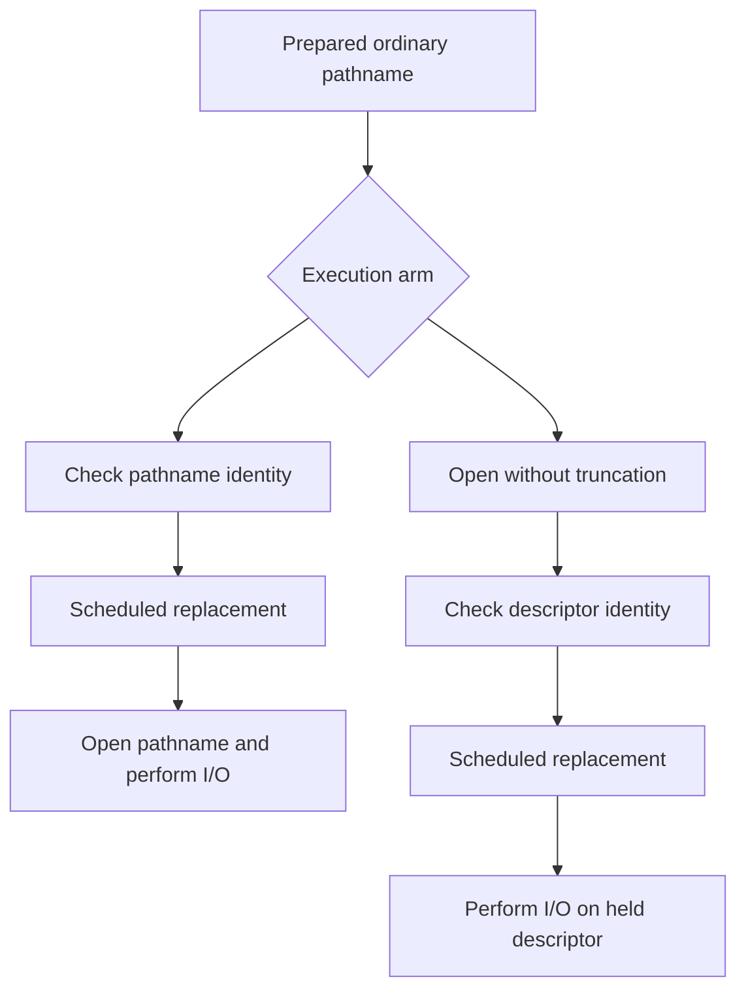

# Architecture: decisions, resources, and execution

**Status:** implemented components through Phase 8. Updated 2026-11-02 (Asia/Seoul).

## System boundary

CodeGuardian separates proposal classification from execution and observation. The original command-line checker returns decisions without touching the proposed file. Experiment runners construct disposable fixtures, execute bounded operations, and measure effects. There is no live-agent adapter.

| Component | Input or responsibility | Binding and limitation |
|---|---|---|
| `src/codeguardian.py` | Synthetic JSON operation/path | Lexical policy; no filesystem resolution or action execution |
| `src/executor_gate.py` | Frozen `PreparedAction` | Resolved pathname and copied content; fixed topology |
| `src/identity_gate.py` | Prepared target and configured protected root | Pre-open device/inode check; vulnerable to later replacement |
| `src/descriptor_executor.py` | Existing-file read/write request | Open, authorize with `fstat`, use same descriptor, close |
| `src/verified_content_reader.py` | Read request and trusted target/version mapping | Capture with descriptor executor, validate the value, return that same immutable string |
| `experiments/run_replay.py` | Two-arm fixed task replay | Fixture setup, shared guard, file/read goals |
| `experiments/run_comparison.py` | Three-arm resolved-target comparison | Preserves original replay arms |
| `experiments/run_identity_comparison.py` | Four-arm hardlink comparison | Fixed-topology identity oracle |
| `experiments/run_race_comparison.py` | Three-arm deterministic replacement | Descriptor observations and retained original-object witness |
| `experiments/run_content_comparison.py` | Three-arm same-inode mutation | Version-specific delivery oracle and freshness comparison |
| `src/revision_authority.py` | Approval revision and trusted receipt | Cooperating in-process publishers; no persistence |
| `experiments/run_revision_comparison.py` | Three-arm approval-transition comparison | Ordered receipt/publication journal |
| `src/publication_store.py` | Split-file and SQLite-row publication/recovery | Trusted single writer; process-exit fault model |
| `experiments/recovery_worker.py` | Publisher child and declared exit checkpoint | Exact exit/event sequence; no host-crash simulation |
| `experiments/run_recovery_comparison.py` | Three storage/recovery arms | Coherent states, valid delivery, and commit/acknowledgment counts |
| `experiments/verify_recovery_results.py` | Independent artifact recount | Raw grid, traces, counters, criteria, source/input hashes |

## Phase 5 ordering



The diagram shows the after-check schedule and omits denial branches for clarity. The before-check schedule substitutes the file before either arm's authorization. The no-gate baseline uses the pathname branch without a decision. The changed order of open and authorization is the intervention.

`DescriptorExecutor` owns the descriptor lifetime in a `try/finally`. It permits only existing regular-file reads and text writes, opens without creation or truncation, checks configured protected identities, and uses descriptor operations after approval. Truncation is delayed until approved write execution; short writes are handled until the content is exhausted. Unsupported requests are denied and metadata failures propagate as errors. Trusted hooks mark experiment boundaries; they are not an agent extension API.

An open used for authorization still counts as an open. The new executor provides no general containment guarantee against arbitrary symlink, mount, or policy changes before the open. The tested controller only installs known in-fixture replacements, and protected membership is static.

## Phase 6 delivery boundary

`VerifiedContentReader` composes the unchanged descriptor executor. The owner supplies a target-to-SHA-256 mapping, copied into a read-only view; the action cannot supply its own expected digest. Unknown target versions and non-read operations are denied. Resource authorization still runs before capture, so a matching content digest cannot override a protected-file identity denial.

The executor returns a captured UTF-8 string after closing its descriptor. The reader hashes the exact re-encoded bytes, rejects a mismatch without returning the payload, and otherwise returns the same immutable value. Its trusted post-validation hook can change the live file but not redirect the captured value. There is no second file read for delivery and no streaming release before validation.

The diagnostic hash/reread arm instead inspects with `pread` inside the executor's `before_io` hook, preserving the file offset, then permits the unchanged executor's normal read. A content change between those reads can invalidate the earlier digest. Both methods may inspect unapproved bytes before denying delivery. A buffer is not an atomic filesystem snapshot or a freshness guarantee.

## Oracles and trust

Phases 2–4 evaluate declared fixture goals and protected resources. Phase 5 separately retains a hardlink to the original ordinary file and a descriptor for the protected file. The actual I/O descriptor supplies the observed identity; read hashes and final file hashes support the content outcomes. The policy never receives the oracle descriptor or expected outcomes.

The harness, policy inventory, scheduling hooks, and descriptor ownership are trusted. Oracle and intervention both use OS identity semantics, so the comparison cannot validate those semantics independently. Synthetic fixture isolation is experimental infrastructure, not a deployable sandbox.

Phase 6 holds a separate ordinary-file descriptor and compares returned bytes directly with predefined approved bytes and final live bytes. Its controller writes through a hardlink; the oracle checks that target, alias, and descriptors retain the original inode. Policy and oracle share the approved-version definition by design; the oracle does not infer success from the reader's decision. Hash/length records support artifact recounting, while in-run outcomes use direct byte equality.

## Interfaces

The original checker consumes one JSON value per nonblank stdin line. Valid action objects have string `operation` and nonempty string `path`; operations normalize whitespace/case, and paths normalize slash spelling. Supported operation names are `read`, `write`, `create`, and `preview`. The conservative lexical policy rejects absolute paths, dot/parent components, unknown operations, and protected/outside paths. Extra fields are ignored.

```json
{"operation":"read","path":"workspace/notes.txt"}
```

The CLI returns `decision`, `reason`, `operation`, `path`, and input `line`. Invalid JSON or malformed records are blocked. A decision is not an executed operation.

`PreparedAction(operation, target, content)` is an immutable dataclass supplied by trusted preparation. It prevents later raw-request mutation from changing the inspected request. Immutability of the Python object does not freeze the filesystem object named by `target`.

Phase 5 uses a separate manifest schema, `race-eval-v1`, containing `case_id`, `operation`, `timing`, and `replacement`. It accepts only documented schedule enums and constructs fixed fixture paths internally. Raw records include event order, opened/I/O identities, content hashes, status, and outcome flags. Summary counts require exactly one record for every declared case/arm pair.

Phase 6's `content-eval-v1` manifest contains `case_id`, `fixture`, `timing`, and `mutation`, restricted to documented strings. It constructs paths internally. Records include approved, inspected, delivered, and final hashes/lengths; identity observations; events; and separate error, denial, and delivery outcomes. An empty returned value is a delivery, not a missing value.

## Validation and remaining obligations

The Phase 6 recorded test run passed 67 tests: 11 policy, 12 replay, 13 resolved-gate, 8 identity, 11 descriptor/runner, and 12 verified-content/runner tests. Test success verifies these behaviors and regressions; it is not a completeness proof. See [evidence](CONTENT_FINDINGS.md#evidence-and-reproduction).

Before production use, the design would need directory confinement, creation semantics, dynamic protected membership, trusted version distribution, stale-value handling, capture-time mutation semantics, resource limits, and hostile-object handling. Selected same-inode changes have now been tested at fixed boundaries; arbitrary concurrent changes have not. Before agent claims, a real adapter and task-level evaluation are required. Each comparison remains tied to its own protocol.

## Phase 7: revision authority and receipt

`src/revision_authority.py` maintains an immutable approval snapshot and a monotonic revision. `try_publish` acquires a non-reentrant lock without blocking; the caller must retry a busy publication. `release` checks revision and digest and invokes a short trusted receiver under that same lock. It must not synchronously call blocking authority methods. Publication callbacks can write bytes before approval commitment; exceptions propagate and do not promise rollback.

`experiments/run_revision_comparison.py` constructs fresh fixtures, captures using the unchanged verified reader, and compares three release mechanisms. An ordered journal distinguishes requested, deferred, and committed publication from receipt. Summaries revalidate saved oracle assessments against journals. The Phase 7 run passed 85 tests, including 18 revision tests. [Findings and limits](REVISION_FINDINGS.md).

## Phase 8: the persistence boundary

`SplitPublicationStore` in `src/publication_store.py` individually syncs and atomically replaces the payload and approval JSON, in that order. The pair has no shared transaction. `SQLitePublicationStore` stores payload, digest/revocation, and revision in one row under explicit `BEGIN IMMEDIATE`/`COMMIT`, checking `DELETE` journal mode and `FULL` synchronization. `recover_value` validates and returns the same captured bytes, or denies a mismatch/revocation without returning a payload.

The experiment is a separate trusted-fixture storage prototype. It does not replace the earlier descriptor executor, hold an authorization lock across live actions, or approve a mutable external pathname through the database.

`experiments/recovery_worker.py` publishes fixed fixture values and calls `os._exit(73)` at one declared application checkpoint. `run_recovery_comparison.py` requires the exact process result and flushed event sequence, reopens a fresh store, and compares direct recovered bytes/revision with the declared old/new state. `verify_recovery_results.py` independently recounts observations without importing the runner or stores. It validates the 57-row grid, traces, counters, criteria, and source hashes. The current regression suite passes 111 tests.

The parent, OS, and disk remain available. No interruption occurs inside SQLite commit, fsync, or replacement. Acknowledgments are test events in a parent-captured pipe. A committed but unacknowledged publication can survive; safe request retries and distributed acknowledgment durability are not implemented. [Results and limits](RECOVERY_FINDINGS.md).
